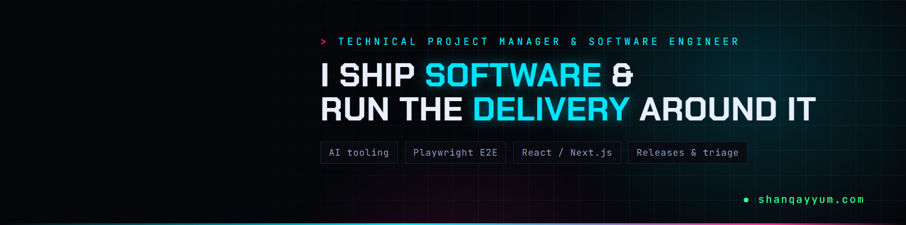

  
  
  
  
  

## Shan Qayyum

**Technical Project Manager & Software Engineer.** I run delivery for software & ERP teams: releases, issue triage, approval workflows. Based in Lahore, Pakistan (PKT, UTC+5). Open to remote work worldwide.

About two years building business systems for compliance, healthcare and e-commerce teams. I design the workflows people work inside, run production support on live sites, and test releases end to end before they ship.

### Delivery, with numbers

| Area | What I delivered |
|---|---|
| **Approval workflow** | Replaced manual Word templates with an ERPNext workflow (Draft → In Review → Approved For Use): role-based permissions, in-review edit locks, 5 custom DocTypes with frozen snapshots, and an automated 4-page RAMS PDF per task |
| **Release gating** | Shipped a customised mail client on 4 Linux/macOS channels, each release gated by 27 automated end-to-end test suites |
| **Issue triage** | Ran a 14-issue P0–P3 register on a live store, plus tagged releases, pre-change backups and a documented rollback |
| **Incident** | Found why ~12 customer quote requests in 10 days never reached sales (rejected by Google's email checks) and fixed delivery with SPF/DKIM/DMARC |
| **QA at scale** | Tested 70 pages × 7 screen sizes with Playwright and cut tap-target defects from 452 to 156 (WCAG 2.1 AA). Lighthouse SEO 61 → 100 |

### Case studies

| Case study | What it shows |
|---|---|
| [ERP workflow automation for an engineering firm](https://shanqayyum.com/work/erp-automation/) | Approval stages, permissions and generated compliance documents in ERPNext |
| [Company mail: PWA + single sign-on](https://shanqayyum.com/work/mail-pwa-sso/) | Keycloak SSO rollout and release gating with 27 E2E test suites |
| [SEO & performance overhaul: Lighthouse 61 → 100](https://shanqayyum.com/work/seo-performance/) | Redirect chains, Search Console errors and accessibility fixed at scale |
| [WooCommerce → lab fulfillment integration](https://shanqayyum.com/work/woocommerce-fulfillment/) | Order hand-off to a lab's API with retry queues |

### Delivery toolkit

### Build stack

### Quality & ops

### Currently

- 🛠️ Web Developer, Production Support: e-commerce packaging company (remote, since Jul 2026)
- 🔐 Full-Stack Engineer & Security Specialist: HIPAA-regulated telehealth platform (remote, since Jul 2026)
- 🎓 B.S. Computer Science, University of the Punjab (2021–2026)
- 🎯 Looking for: Technical Project Manager, Project Coordinator, Product Owner and Delivery roles

Most of my client work is in private repositories. The case studies at <a href="https://shanqayyum.com">shanqayyum.com</a> describe it without client code.
